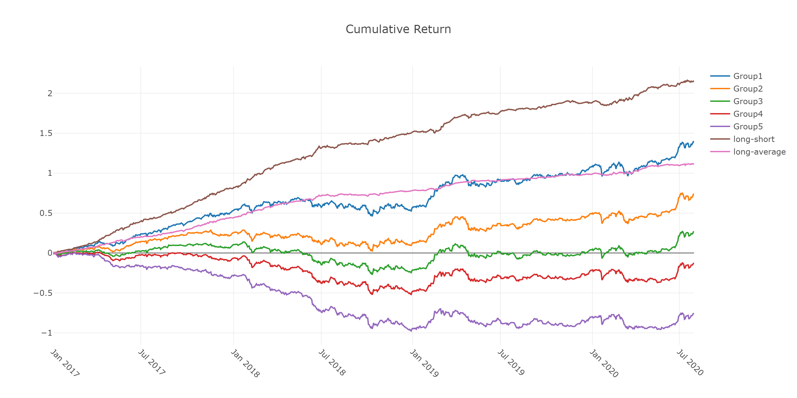
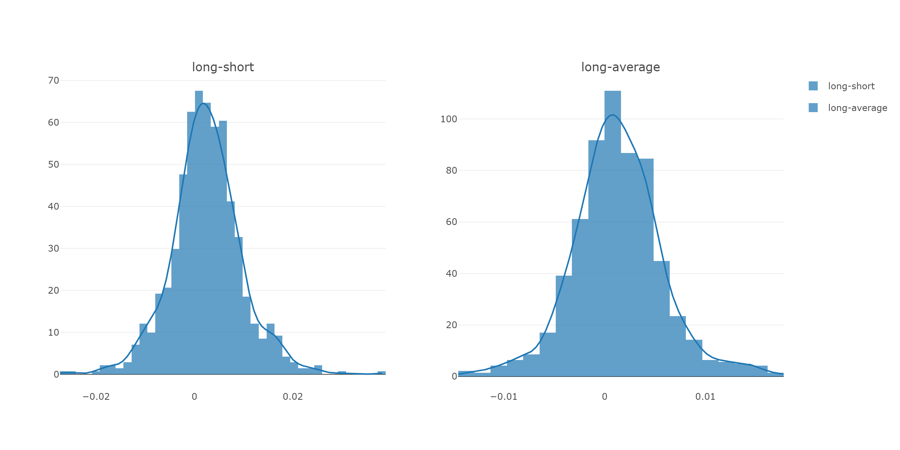
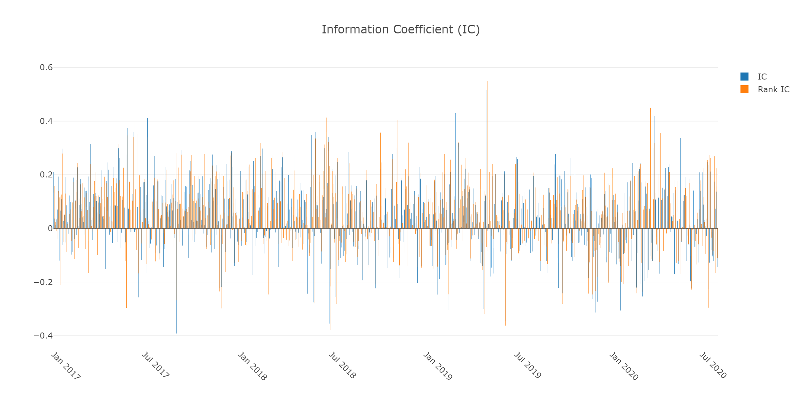
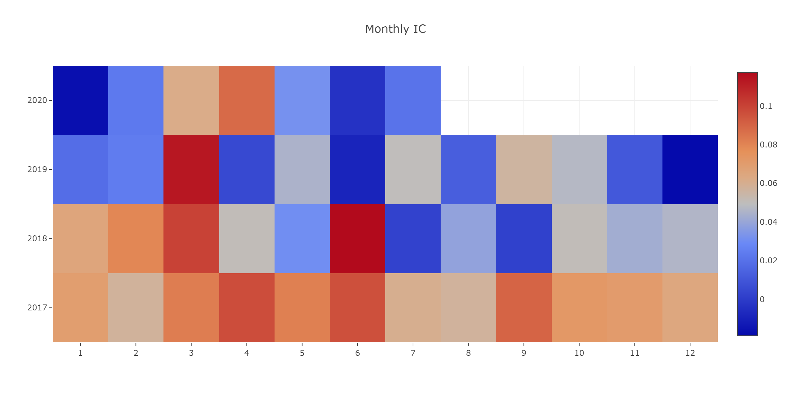
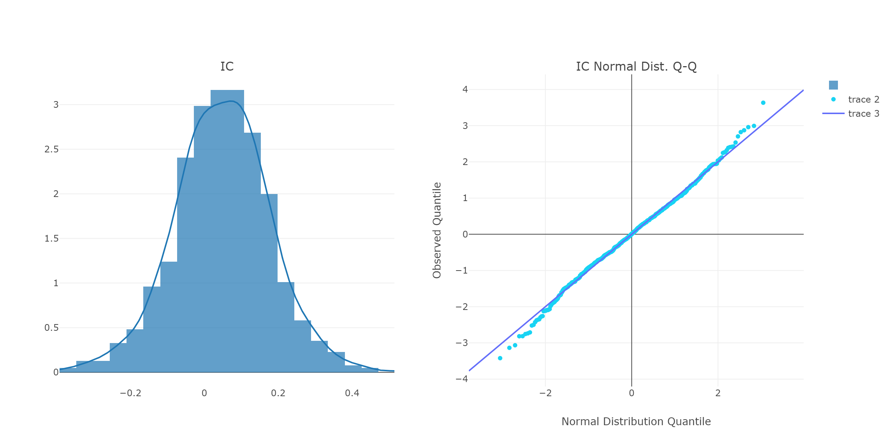
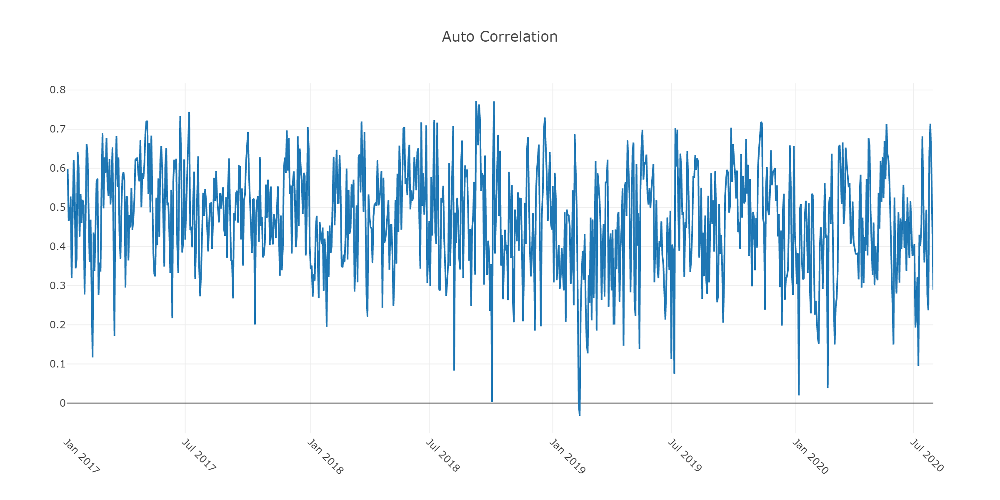
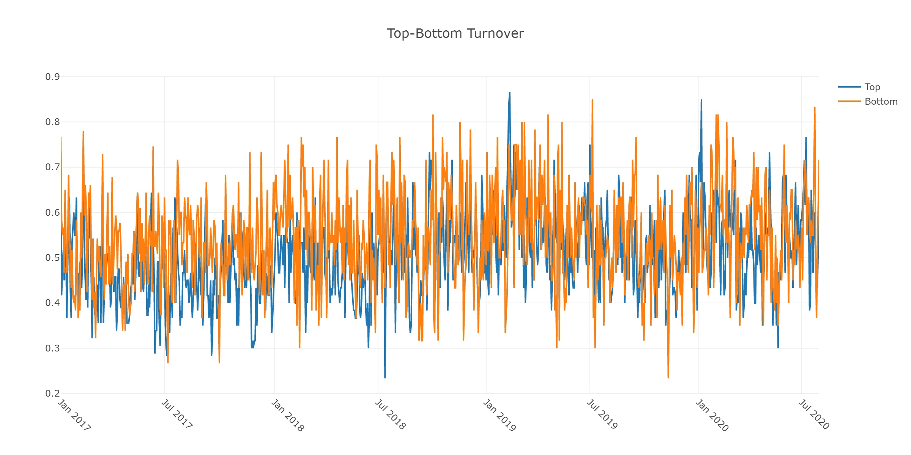

# Model Performance Report

This report is generated by `analysis_model.model_performance_graph(pred_label)` from Qlib.

**Data source**: `pred.pkl` from MLflow run at `7e84c6903cc6445c84ccad28764ce156`

**pred_label shape**: 261207 rows x 2 columns

## Function Overview

`model_performance_graph` is a comprehensive model evaluation function in Qlib that generates multiple diagnostic charts to assess the quality of a predictive model for financial time series.

### Parameters

| Parameter | Description |

|---|---|

| `pred_label` | DataFrame with MultiIndex `[instrument, datetime]`, columns `score` and `label` |

| `lag` | Lag for autocorrelation computation (default: 1) |

| `N` | Number of groups for cumulative return (default: 5) |

| `reverse` | If True, reverse score direction |

| `rank` | If True, use Rank IC (Spearman) instead of Pearson |

| `graph_names` | List of graph types to generate |

| `show_notebook` | Whether to display in notebook (default: True) |

| `show_nature_day` | Whether to show non-trading days on x-axis |


## Generated Charts

### 1. Group Cumulative Return



| Metric | Value | Verdict |
|---|---|---|
| Group 1 (highest score) cumulative return | **+138.5%** | ✅ |
| Group 5 (lowest score) cumulative return | **-75.8%** | ✅ |
| Long-Short (Group1 - Group5) cumulative | **+214.3%** | ✅ |
| Group monotonicity (G1 > G2 > ... > G5) | **Yes** | ✅ |
| Long-Short daily mean | **+0.246%** | ✅ |
| Long-Short daily std | 0.716% | — |
| Positive day ratio | **65.0%** | ✅ |

**Interpretation**: This is a **strong result**. The chart shows clear separation between groups:
- Group 1 (highest model score) consistently trends upward, accumulating ~138% return over the test period.
- Group 5 (lowest model score) trends downward to -76%.
- The groups are perfectly monotonic — each higher group outperforms the lower group.
- The Long-Short strategy (buy Group 1, short Group 5) produces ~214% cumulative return with positive returns on 65% of days.

> **What to look for**: Ideal charts show Group 1 at the top (green), Group 5 at the bottom (red), with smooth monotonic separation. If groups cross or reverse, the model lacks discriminatory power.

---

### 2. Long-Short / Long-Average Distribution



| Metric | Value | Verdict |
|---|---|---|
| Long-Short daily mean | **+0.246%** | ✅ |
| Long-Short positive ratio | **65.0%** | ✅ |

**Interpretation**: The Long-Short return distribution is **centered clearly above zero**, confirming that the model's top picks outperform its bottom picks on most days. The distribution has a roughly bell-shaped curve with a positive mean, which is exactly what you want to see. The Long-Average distribution (Group 1 vs market average) should also be shifted positive, indicating the top group beats the market.

> **What to look for**: The Long-Short histogram should be centered to the right of zero. A negative or near-zero mean indicates the model's ranking is not effective.

---

### 3. IC (Information Coefficient) — Daily Bar Chart



| Metric | Value | Verdict |
|---|---|---|
| Mean IC (Pearson) | **0.0486** (4.86%) | 🟡 Decent |
| IC Std | 0.1288 (12.88%) | — |
| IC IR (Information Ratio) | **0.38** | 🟡 Acceptable |
| Positive IC ratio | **65.7%** | 🟡 Decent |
| Mean Rank IC (Spearman) | **0.0517** (5.17%) | 🟡 Decent |
| Rank IC positive ratio | **68.1%** | ✅ Good |

**Interpretation**: The model has **moderate but consistent predictive power**. A mean IC of ~5% is a decent level for Chinese A-share quantitative models. The IC IR of 0.38 is acceptable (industry target is typically > 0.5 for production). The model is correct 65-68% of the time in its directional predictions, which is above the 50% random baseline. The Rank IC is slightly higher than the Pearson IC, suggesting the model is better at ranking stocks than predicting exact magnitudes.

> **What to look for**: Mean IC > 0.03 is usable; > 0.05 is good. IC IR > 0.5 is strong. Positive ratio > 55% is the minimum threshold. The blue bars should be mostly above the zero line.

---

### 4. Monthly IC Heatmap



| Metric | Value |
|---|---|
| Monthly IC mean | **0.0485** (4.85%) |

**Interpretation**: The heatmap shows the model's performance across different months. Green cells indicate positive IC months, red cells indicate negative IC months. **Green should dominate**. Look for:
- **Consistent green across years** → model is stable across market regimes.
- **Red clusters** in specific months → possible regime dependency that needs investigation.
- **Seasonal patterns** → may indicate the model works better/worse in certain periods.

> **What to look for**: Overall green (positive) bias. No large contiguous red blocks. Consistent performance across different years suggests the model generalizes well.

---

### 5. IC Distribution & Q-Q Plot



| Metric | Value | Verdict |
|---|---|---|
| IC Mean | **+0.0486** | ✅ Positive shift |
| IC Std | 0.1288 | — |

**Interpretation**: The **histogram** should be centered (mean line) to the **right of zero**, which it is at +4.9%. This means the model's predictions are net positive on average. The **Q-Q plot** compares the IC distribution against a theoretical normal distribution:
- Points along the diagonal = IC is normally distributed → ✅ ideal for statistical inference.
- S-curve shape = heavier tails than normal → typical for financial data, not a major concern.
- Points far from the line = significant deviations from normality.

> **What to look for**: Histogram mean > 0 and clearly shifted right of zero. Q-Q line roughly follows the diagonal.

---

### 6. Prediction Autocorrelation



| Metric | Value | Verdict |
|---|---|---|
| Mean autocorrelation (lag=1) | **0.469** (46.9%) | 🟡 Moderate |

**Interpretation**: This measures how similar today's score predictions are to yesterday's. A value of ~47% is **moderate and acceptable**:
- **Too low (< 0.2)** → predictions are noisy, model may be overfitting to daily noise.
- **Too high (> 0.8)** → predictions are stale, model is not incorporating new information (effectively repeating yesterday's prediction).
- **Moderate (0.3 - 0.6)** → ✅ good balance between stability and responsiveness. The model updates its view based on new data while maintaining conviction.

> **What to look for**: Values in the 0.2-0.6 range are generally healthy. Very high autocorrelation suggests the model's features are too static.

---

### 7. Top-Bottom Turnover



| Metric | Value | Verdict |
|---|---|---|
| Top group daily turnover | **50.4%** | 🟡 Moderate |
| Bottom group daily turnover | **54.6%** | 🟡 Moderate |

**Interpretation**: Turnover measures what fraction of stocks in the top/bottom group are replaced each day. ~50% means roughly half the stocks change daily:
- **This is moderate and realistic** — not too static (which would suggest stale signals) and not too high (which would cause excessive trading costs).
- The top and bottom turnover are similar (50.4% vs 54.6%), suggesting symmetric signal decay.
- High turnover (> 80%) may indicate the model has poor signal stability and high trading costs would erode returns.

> **What to look for**: Turnover in the 30-60% range is typical. Very low turnover (< 20%) may indicate the model is not updating; very high (> 80%) suggests the signal is too noisy and trading costs will be problematic.

---

## Overall Assessment

| Dimension | Score | Summary |
|---|---|---|
| **Discrimination** (Group Return) | ✅ **Strong** | Clear monotonic separation, Long-Short cumulative +214% |
| **Predictive Accuracy** (IC) | 🟡 **Decent** | Mean IC 4.9%, IC IR 0.38, 66% positive days |
| **Signal Quality** (Rank IC) | 🟡 **Decent** | Rank IC 5.2%, 68% positive days |
| **Signal Stability** (Autocorr) | 🟡 **Acceptable** | 47% autocorrelation — reasonable balance |
| **Practicality** (Turnover) | 🟡 **Acceptable** | ~50% daily turnover — moderate trading costs |

**Bottom Line**: This LightGBM model (Alpha158, CSI300) demonstrates **statistically significant predictive power**. The long-short cumulative return of 214% is impressive, though the IC IR of 0.38 suggests there is room for improvement. The model is suitable as a baseline or component in a multi-factor ensemble.


## Usage Example

```python

from qlib.contrib.report.analysis_model import model_performance_graph


figure_list = model_performance_graph(

    pred_label,

    show_notebook=False,

    graph_names=['group_return', 'pred_ic', 'pred_autocorr', 'pred_turnover'],

)


for i, fig in enumerate(figure_list):

    fig.write_image(f'figure_{i}.png', width=1200, height=600, scale=2)

```